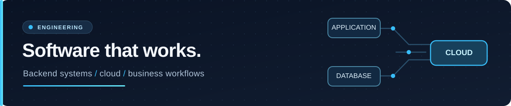

  

<h1 align="center">Nigel Matekwa Alufwani</h1>

  <strong>Software Engineer · Backend & Full-Stack · Cloud & DevOps</strong> 
  Nairobi, Kenya

  <a href="mailto:nigelmatekwa@gmail.com">Email</a> ·
  <a href="https://linkedin.com/in/nigel-matekwa">LinkedIn</a> ·
  <a href="https://github.com/Night-ryder254?tab=repositories">Repositories</a>

I build business-focused web applications and backend services, with particular attention to reliable data workflows, access control, and maintainable code. My work combines Laravel/PHP and Python/FastAPI with practical cloud, Linux, and containerization experience.
Selected work
- SokoTrack — B2B wholesale ordering with M-Pesa integration, USSD, credit terms, and transaction-safe inventory adjustments. Laravel · MySQL · Alpine.js
- Delivery Management & Tracking — Four-role logistics workflows, QR scanning, authorization policies, and row-locked rider assignment. Laravel · Docker · MySQL
- ShiftLog — Multi-branch shift and attendance management with scoped access and automated authorization tests. Laravel · MySQL · PHPUnit
- Northstar Inventory Sync — Inventory API with warehouse polling, HMAC-verified webhooks, and idempotent updates. Python · FastAPI · SQLAlchemy — sprint simulation
- Solstice Check-In Kiosk — QR check-in with Redis Streams, asynchronous print jobs, and webhook-driven completion. Python · FastAPI · Redis — sprint simulation
Engineering toolkit
Languages & backend: PHP · Laravel · Python · FastAPI · JavaScript · SQL · REST APIs

Cloud & delivery: AWS · Docker · Linux · Nginx · Bash · Git/GitHub

Engineering practices: Role-based authorization · database transactions · webhook integrations · automated testing · API and system design
How I approach engineering
I focus on the details that make business software dependable: clear permissions, traceable state transitions, consistent database changes, and testable integrations. My portfolio includes practical deployment work and explicitly identified sprint simulations. Individual repositories document their architecture, trade-offs, and setup instructions for reviewers who want to go deeper.
Credentials & experience
- BSc Information Technology, KCA University (2026) · AWS Certified Cloud Practitioner · AWS re/START graduate (training).
- IT Support Attachee, Eastland Hotel Limited (2025): endpoint, network, and infrastructure support.
- Freelance data annotation & transcription (2023–present): labeling, transcription, and data quality work.
Work with me
Open to junior software/backend engineering and cloud/DevOps roles, as well as freelance work on business applications, dashboards, APIs, integrations, and workflow automation.

Have a role or project to discuss? Email me or connect on LinkedIn.
